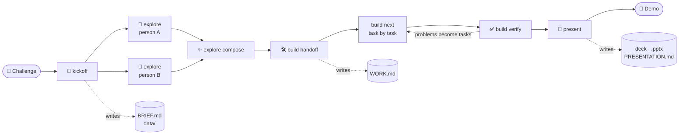

<p align="center">
  
</p>

<h1 align="center">track-to-demo</h1>

<p align="center">
  <b>Morning: a challenge. Evening: a working prototype and a pitch deck.</b><br>
  A Claude Code plugin that walks your team through the whole day, so you can focus on the idea.
</p>

<p align="center">
  
  
  
</p>

<p align="center">
  <a href="#setup-once-per-person-5-minutes">Setup</a> ·
  <a href="#the-day-step-by-step">The day</a> ·
  <a href="#files-that-appear-in-your-project">Files</a> ·
  <a href="#words-you-might-not-know">Glossary</a>
</p>

---

## Why you'll like it

Hackathons and time-boxed prototypes go wrong in the same ways. Hours go into deciding instead of building. Five people end up designing five apps. Someone's work gets overwritten an hour before the demo. The slides show numbers nobody can back up.

track-to-demo gives the day a backbone:

- 🧭 **One shared plan in 15 minutes.** Paste the challenge; Claude pulls out the goals, judging criteria and deadlines, and asks only what it can't work out by itself.
- 🎨 **Design ideas side by side, then one direction.** Each person sketches a direction on a claude.ai board from images they like; the team picks the best parts and Claude merges them.
- 🛠️ **Building that holds together.** Small tasks with one owner each, real tests, and a check against the challenge's criteria before every freeze.
- 🎤 **A deck you can defend.** Real screenshots, real data, mock-ups labelled as mock-ups, and on your company template if you have one.
- 🧑‍🤝‍🧑 **Made for people new to AI.** Plain words, few options, one recommendation. No prompt writing needed.

## How the day flows



Five commands, one per phase. Everything is written into plain files in your repository, so the whole team, and Claude, always start from the same facts.

---

## What you need before starting

| What | Why | How to check |
|---|---|---|
| **Claude Code** (terminal or the Code tab of the Claude Desktop app) | The plugin runs inside it | Type `claude` in a terminal |
| **A claude.ai account**, logged in | Design boards and the slide deck live on claude.ai | Inside Claude Code, type `/login` |
| **Your team in the same claude.ai organization** | So you can share boards with each other | Ask whoever manages your claude.ai account |
| **A folder with your project** (it can be empty) | The prototype is built there | Open the folder in a terminal |
| **Google Chrome** (optional but recommended) | Claude checks the app in the browser | Start Claude with `claude --chrome` |

No claude.ai login? It still works: the design ideas become pages of your app instead of boards, and the deck stops at the outline and script.

---

## Setup (once per person, ~5 minutes)

Three steps. You only copy and paste.

### Step 1: open Claude Code

In a terminal, inside your project folder:

```
claude --chrome
```

Then, inside Claude Code, log in to claude.ai (skip it if you are already logged in):

```
/login
```

### Step 2: let Claude install everything

Copy this whole message and paste it inside Claude Code:

```
Install the track-to-demo setup for me. Run these commands in the terminal, one at a time.
If one says the marketplace or plugin is already there, that's fine: go on.
If one fails for another reason, go on with the rest and tell me at the end what failed and why.

claude plugin marketplace add sassarini-marco/track-to-demo --scope local
claude plugin install track-to-demo@track-to-demo --scope local
claude plugin install frontend-design@claude-plugins-official --scope local
claude plugin marketplace add pbakaus/impeccable --scope local
claude plugin install impeccable@impeccable --scope local
claude plugin marketplace add anthropics/skills --scope local
claude plugin install document-skills@anthropic-agent-skills --scope local

Then, only if this folder is empty or has a components.json (a React app with shadcn/ui), run
npx skills add shadcn/ui --skill shadcn
with the package runner this project uses (npx, pnpm dlx, yarn dlx or bunx).

Finally, make sure the .gitignore in this folder has the line .claude/settings.local.json (create the file if it is missing).

Install nothing else. When you're done, tell me what was installed and remind me to type /reload-plugins and /reload-skills.
```

Claude asks your permission before each command: say yes.

Everything is installed **only in this project and only for you** (`--scope local`): your other projects don't change. The settings file that records it, `.claude/settings.local.json`, is added to `.gitignore`, so it never ends up in git. For another project, repeat the setup there.

What gets installed:

- **track-to-demo**: this plugin (required);
- **frontend-design**: better-looking interfaces;
- **impeccable**: polishes designs and checks the UI for the typical "made by AI" look;
- **document-skills**: exports the final deck as a `.pptx` on your company template;
- **shadcn** (only for React apps with shadcn/ui, the default for new projects): helps Claude use those components correctly.

### Step 3: reload and check

No need to leave Claude Code. Inside it, one line at a time:

```
/reload-plugins
```

```
/reload-skills
```

```
/plugin
```

You should see `track-to-demo`, `frontend-design`, `impeccable` and `document-skills` in the list. `kickoff` also checks the helpers and tells you if anything is missing.

<details>
<summary>Prefer to install by hand? Same result, one command at a time</summary>

Inside Claude Code, one line at a time:

```
! claude plugin marketplace add sassarini-marco/track-to-demo --scope local
```

```
! claude plugin install track-to-demo@track-to-demo --scope local
```

```
! claude plugin install frontend-design@claude-plugins-official --scope local
```

```
! claude plugin marketplace add pbakaus/impeccable --scope local
```

```
! claude plugin install impeccable@impeccable --scope local
```

```
! claude plugin marketplace add anthropics/skills --scope local
```

```
! claude plugin install document-skills@anthropic-agent-skills --scope local
```

Only for React apps with shadcn/ui (the `!` at the start runs the command as if you typed it in a terminal, without leaving Claude; with `pnpm`, `yarn` or `bun` use `pnpm dlx`, `yarn dlx` or `bunx` instead of `npx`):

```
! npx skills add shadcn/ui --skill shadcn
```

Then do Step 3.

</details>

---

## The day, step by step

Everyone opens Claude Code in the project folder. Each step is one command.

### 1. 🧭 Kickoff (one person, ~15 minutes)

Have a company slide template (`.pptx` or `.potx`)? Before starting, create a folder called `templates` in your project and put the file there. Claude keeps that folder out of git, so company files are never uploaded by mistake. No template? Skip this: the deck can still be downloaded as `.pptx`.

Did the challenge come with data files (spreadsheets, CSV, JSON…)? Put them in a folder called `data` in your project. Claude keeps them out of git too.

```
/track-to-demo:kickoff
```

Paste the challenge text (or give a file path or link). Claude:

- summarises goals, judging criteria and deadlines, and asks you to confirm;
- looks at your code to understand the technology already in use. If the folder is empty, it proposes **TypeScript + React with shadcn/ui** and asks you to confirm;
- asks, all at once, only what's missing: who's in the team, the schedule, the idea, the design system, the slide template;
- lists the data the prototype will use and, for whatever is missing, creates realistic **made-up (synthetic) data** in `data/`, so designs, app and slides all show the same numbers;
- writes everything in **`BRIEF.md`**, the shared plan every later step reads.

Then **each person who explores a design** puts 2-3 images they like (screenshots of apps, websites, anything) in `explorations/references/<their-name>/`.

### 2. 🎨 Explore designs (each explorer, in parallel)

```
/track-to-demo:explore anna
```

(use your own name). Claude creates a design board on claude.ai from your reference images, with the main screen and the empty and error states. Share the board with the team (**Share → edit access**).

### 3. ✨ Pick the final design (team)

Look at the boards together and say what you like from each one, for example *"layout from Anna, colours from Luca"*. Then:

```
/track-to-demo:explore compose
```

Claude builds the **"Final direction"** board from your choices. Not sure what to pick? Run it anyway: Claude compares the boards and recommends a mix, then asks before building it.

### 4. 🛠️ Build (developers)

```
/track-to-demo:build handoff
```

Run it once. Claude splits the work into small tasks, each with one owner, and writes them in **`WORK.md`**.

```
/track-to-demo:build next
```

Each developer runs this to do their next task. Claude writes the code, adds tests, runs them and commits. Repeat until your tasks are done.

```
/track-to-demo:build verify
```

Run this before each checkpoint and before the final freeze. Claude checks the prototype against the challenge's criteria and adds any problem it finds as a new task.

### 5. 🎤 Present (presenter)

```
/track-to-demo:present
```

Claude proposes the slide outline, builds the deck with real screenshots, waits for the team's comments and approval, then exports the `.pptx` on your template. It also writes **`PRESENTATION.md`** with the script and likely questions from the judges.

---

## Files that appear in your project

Claude creates and fills these in. The only things you add yourself are your slide template in `templates/` and any data files that came with the challenge in `data/`.

| File | What's in it |
|---|---|
| `BRIEF.md` | The plan: challenge, goals, team, schedule, technology, rules |
| `explorations/` | Reference images and links to everyone's design boards |
| `WORK.md` | The task list: who does what, status, test evidence |
| `PRESENTATION.md` | Demo script, speaker notes, Q&A |
| `data/` | The data the prototype uses. Synthetic data is saved in git so the whole team has it; files from the challenge stay out of git |
| `templates/` | Your slide template and the final `.pptx`. You create it; it stays out of git |

---

## Words you might not know

- **Track**: the challenge you received.
- **Board**: a canvas on claude.ai where Claude draws screen designs.
- **Design system**: a set of colours, fonts and components, so everything looks consistent.
- **Contract freeze**: the moment the team stops changing how the pieces talk to each other, so everyone can work in parallel safely.
- **Feature freeze**: the moment you stop adding things and only fix and rehearse.
- **Commit / push**: saving your work in git / sending it to GitHub.

---

## Good to know

- Claude replies in your language.
- Claude never invents numbers or results, and labels mock-ups as mock-ups.
- Claude never installs anything on its own and never handles passwords: when something is missing, it tells you the command to run. It installs only when you ask, as in the setup.
- Boards and decks need an interactive session. They don't work with `claude -p`.
- To read someone else's board you need **edit** access. With view access Claude only gets a summary.
- Checking the app in the browser is useful, but it doesn't replace your tests.

---

## For plugin developers

```sh
claude plugin validate .
claude --plugin-dir .
```

## License

MIT
