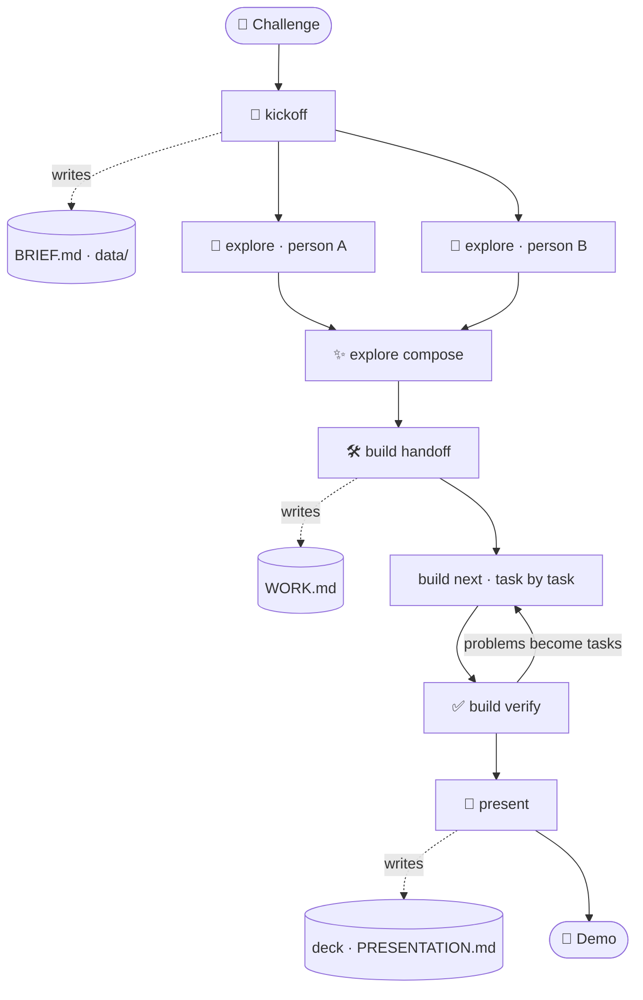

<p align="center">
  
</p>

<h1 align="center">track-to-demo</h1>

<p align="center">
  <b>Morning: a challenge. Evening: a working prototype and a pitch deck.</b><br>
  A Claude Code plugin that walks your team through the whole day, so you can focus on the idea.
</p>

<p align="center">
  
  
  
</p>

<p align="center">
  <a href="#-start-in-2-minutes">Start</a> ·
  <a href="#-the-day-at-a-glance">The day</a> ·
  <a href="#why-youll-like-it">Why</a> ·
  <a href="#the-day-in-detail">Details</a>
</p>

---

## ⚡ Start in 2 minutes

Every person, once per project. Copy each box with its copy button.

**1.** In a terminal, inside your project folder (it can be empty):

```
claude --chrome
```

**2.** Paste this inside Claude Code. Claude installs everything; say yes when it asks.

```
Set up track-to-demo in this project, following:
https://raw.githubusercontent.com/sassarini-marco/track-to-demo/main/SETUP.md
```

**3.** When Claude is done, paste these two, one at a time:

```
/reload-plugins
```

```
/reload-skills
```

**4.** Go. One person pastes this, then pastes the challenge text:

```
/track-to-demo:kickoff
```

Not logged in to claude.ai yet? Type `/login` first: boards and slides live there.

---

## 🗺️ The day at a glance

| When | Who | Paste this | You get |
|---|---|---|---|
| Start | one person | `/track-to-demo:kickoff` | `BRIEF.md`: the shared plan, plus realistic demo data |
| Morning | each designer | `/track-to-demo:explore <your-name>` | your design board on claude.ai |
| Late morning | the team | `/track-to-demo:explore compose` | the final design, merged from the best parts |
| Midday | one developer | `/track-to-demo:build handoff` | `WORK.md`: small tasks, one owner each |
| All day | each developer | `/track-to-demo:build next` | your next task built, tested and committed |
| Before each deadline | anyone | `/track-to-demo:build verify` | a check against the judging criteria |
| Afternoon | the presenter | `/track-to-demo:present` | the slide deck and the demo script |

Claude asks only what it can't work out by itself, and replies in your language.

---

## Why you'll like it

Hackathons and time-boxed prototypes go wrong in the same ways. Hours go into deciding instead of building. Five people end up designing five apps. Someone's work gets overwritten an hour before the demo. The slides show numbers nobody can back up.

track-to-demo gives the day a backbone:

- 🧭 **One shared plan in 15 minutes.** Paste the challenge; Claude pulls out the goals, judging criteria and deadlines, and asks only what it can't work out by itself.
- 🎨 **Design ideas side by side, then one direction.** Each person sketches a direction on a claude.ai board from images they like; the team picks the best parts and Claude merges them.
- 🛠️ **Building that holds together.** Small tasks with one owner each, real tests, and a check against the challenge's criteria before every freeze.
- 🎤 **A deck you can defend.** Real screenshots, real data, mock-ups labelled as mock-ups, and on your company template if you have one.
- 🙌 **Less friction, more hackathon.** Claude takes care of the plumbing: setup, plans, task lists, checks, slides. Your time goes to the best part of the day: brainstorming, chasing the idea, the team and the people around you. First-timers and seasoned engineers alike.



Everything is written into plain files in your repository, so the whole team, and Claude, always start from the same facts.

---

## The day in detail

### 1. 🧭 Kickoff (one person, ~15 minutes)

Before starting, two optional things:

- **A company slide template** (`.pptx` or `.potx`)? Put it in a folder called `templates` in your project. Claude keeps it out of git.
- **Data files that came with the challenge** (spreadsheets, CSV, JSON…)? Put them in a folder called `data`. Claude keeps them out of git too.

Then run `/track-to-demo:kickoff` and paste the challenge text (or give a file path or link). Claude:

- summarises goals, judging criteria and deadlines, and asks you to confirm;
- looks at your code to understand the technology already in use. If the folder is empty, it proposes **TypeScript + React with shadcn/ui** and asks you to confirm;
- asks, all at once, only what's missing: who's in the team, the schedule, the idea, the technology (only for an empty folder), the design system, the slide template;
- lists the data the prototype will use and, for whatever is missing, creates realistic **made-up (synthetic) data** in `data/`, so designs, app and slides all show the same numbers;
- writes everything in **`BRIEF.md`**, the shared plan every later step reads.

Then **each person who explores a design** puts 2-3 images they like (screenshots of apps, websites, anything) in `explorations/references/<their-name>/`.

### 2. 🎨 Explore designs (each designer, in parallel)

Run `/track-to-demo:explore <your-name>`. Claude creates a design board on claude.ai from your reference images, with the main screen and the empty and error states. Share the board with the team (**Share → edit access**).

### 3. ✨ Pick the final design (team)

Look at the boards together and say what you like from each one, for example *"layout from Anna, colours from Luca"*. Then run `/track-to-demo:explore compose`: Claude builds the **"Final direction"** board from your choices. Not sure what to pick? Run it anyway: Claude compares the boards and recommends a mix, then asks before building it.

### 4. 🛠️ Build (developers)

- `/track-to-demo:build handoff`, once: Claude splits the work into small tasks, each with one owner, and writes them in **`WORK.md`**.
- `/track-to-demo:build next`, as often as you like: Claude does your next task, writes the code, adds tests, runs them and commits.
- `/track-to-demo:build verify`, before each checkpoint and before the feature freeze: Claude checks the prototype against the challenge's criteria and adds any problem it finds as a new task.

### 5. 🎤 Present (presenter)

Run `/track-to-demo:present`. Claude proposes the slide outline, builds the deck with real screenshots, waits for the team's comments and approval, then exports the `.pptx` on your template. It also writes **`PRESENTATION.md`** with the script and likely questions from the judges.

---

## Setup in detail

### What you need

| What | Why |
|---|---|
| **Claude Code** (terminal, or the Code tab of the Claude Desktop app) | The plugin runs inside it |
| **A claude.ai account**, logged in (`/login`) | Design boards and the slide deck live on claude.ai |
| **Your team in the same claude.ai organization** | So you can share boards with each other |
| **A folder with your project** (it can be empty) | The prototype is built there |
| **Google Chrome** (recommended) | Claude checks the app in the browser (`claude --chrome`) |

No claude.ai login? It still works: the design ideas become pages of your app instead of boards, and the deck stops at the outline and script.

### What the setup message installs

The message points Claude to [`SETUP.md`](SETUP.md), which you can read. It installs:

- **track-to-demo**: this plugin;
- **frontend-design**: better-looking interfaces;
- **impeccable**: polishes designs and checks the UI for the typical "made by AI" look;
- **document-skills**: exports the final deck as a `.pptx` on your company template;
- **shadcn** (only for an empty folder or a React app with shadcn/ui): helps Claude use those components correctly.

Everything is installed **only in this project and only for you** (`--scope local`): your other projects don't change. The settings file that records it, `.claude/settings.local.json`, is added to `.gitignore`, so it never ends up in git. Type `/plugin` to see what's installed.

<details>
<summary>Prefer to install by hand? Same result, one command at a time</summary>

Inside Claude Code, one line at a time (the `!` at the start runs the command as if you typed it in a terminal):

```
! claude plugin marketplace add sassarini-marco/track-to-demo --scope local
```

```
! claude plugin install track-to-demo@track-to-demo --scope local
```

```
! claude plugin install frontend-design@claude-plugins-official --scope local
```

```
! claude plugin marketplace add pbakaus/impeccable --scope local
```

```
! claude plugin install impeccable@impeccable --scope local
```

```
! claude plugin marketplace add anthropics/skills --scope local
```

```
! claude plugin install document-skills@anthropic-agent-skills --scope local
```

Only for an empty folder or a React app with shadcn/ui (with `pnpm`, `yarn` or `bun` use `pnpm dlx`, `yarn dlx` or `bunx` instead of `npx`):

```
! npx skills add shadcn/ui --skill shadcn
```

Add the line `.claude/settings.local.json` to your project's `.gitignore`, then run `/reload-plugins` and `/reload-skills`.

</details>

---

## Files that appear in your project

Claude creates and fills these in. The only things you add yourself are your slide template in `templates/` and any data files that came with the challenge in `data/`.

| File | What's in it |
|---|---|
| `BRIEF.md` | The plan: challenge, goals, team, schedule, technology, rules |
| `explorations/` | Reference images and links to everyone's design boards |
| `WORK.md` | The task list: who does what, status, test evidence |
| `PRESENTATION.md` | Demo script, speaker notes, Q&A |
| `data/` | The data the prototype uses. Synthetic data is saved in git so the whole team has it; files from the challenge stay out of git |
| `templates/` | Your slide template and the final `.pptx`. You create it; it stays out of git |

---

## Words you might not know

- **Track**: the challenge you received.
- **Board**: a canvas on claude.ai where Claude draws screen designs.
- **Design system**: a set of colours, fonts and components, so everything looks consistent.
- **Contract freeze**: the moment the team stops changing how the pieces talk to each other, so everyone can work in parallel safely.
- **Feature freeze**: the moment you stop adding things and only fix and rehearse.
- **Commit / push**: saving your work in git / sending it to GitHub.

---

## Good to know

- Claude never invents numbers or results, and labels mock-ups as mock-ups.
- Claude never installs anything on its own and never handles passwords: when something is missing, it tells you the command to run. It installs only when you ask, as in the setup.
- Boards and decks need an interactive session. They don't work with `claude -p`.
- To read someone else's board you need **edit** access. With view access Claude only gets a summary.
- Checking the app in the browser is useful, but it doesn't replace your tests.

---

## For plugin developers

```sh
claude plugin validate .
claude --plugin-dir .
```

## License

MIT
