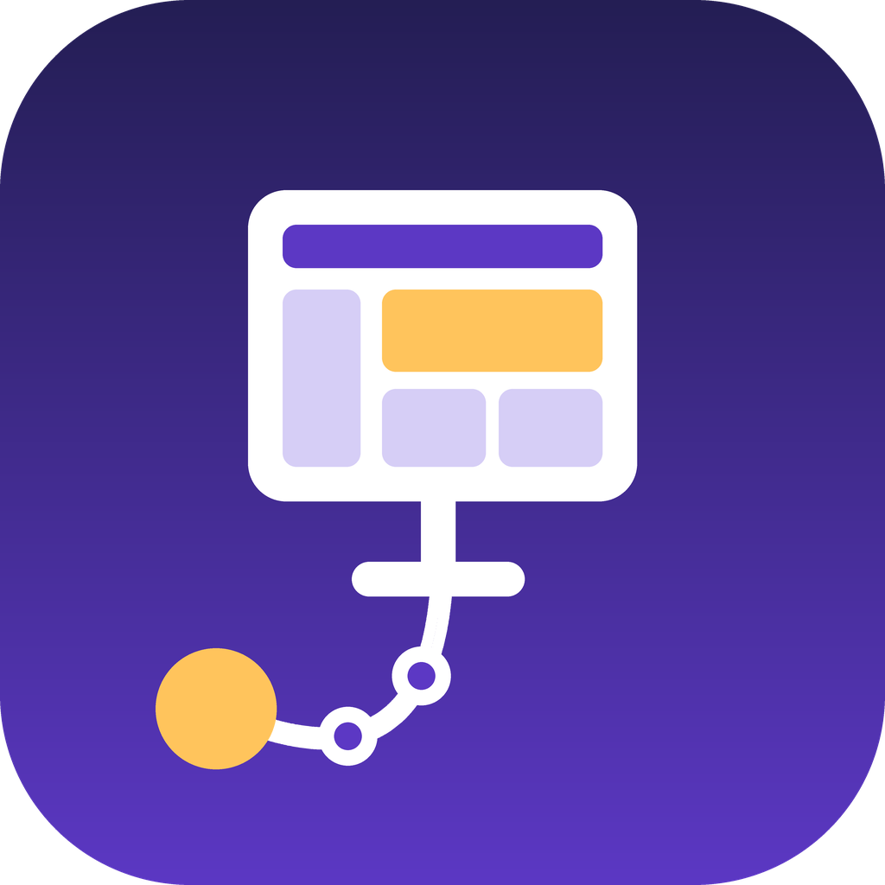
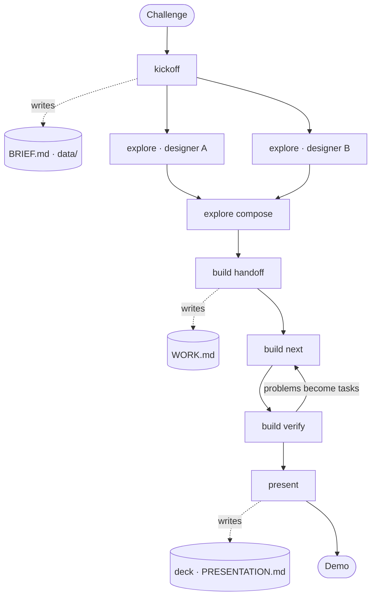

<p align="center">
  
</p>

<h1 align="center">track-to-demo</h1>

<p align="center">
  <b>Morning: a challenge. Evening: a working prototype and a pitch deck.</b><br>
  A Claude Code plugin for hackathon teams. MIT licensed.
</p>

## Start

Everyone on the team does this once, in the project folder. Each box has a copy button.

**1.** Open a terminal in your project folder (an empty one is fine) and start Claude:

```
claude --chrome
```

**2.** Paste this into Claude. It installs everything and asks before each command; say yes.

```
Set up track-to-demo in this project, following:
https://raw.githubusercontent.com/sassarini-marco/track-to-demo/main/SETUP.md
```

**3.** Load what was installed:

```
/reload-plugins
```

```
/reload-skills
```

**4.** One person starts the day. Paste this, then paste the challenge text:

```
/track-to-demo:kickoff
```

Not signed in to claude.ai? Type `/login` first. Design boards and slides live there.

## The day

| When | Who | Paste | You get |
|---|---|---|---|
| Start | one person | `/track-to-demo:kickoff` | `BRIEF.md`, the plan everyone works from, and demo data |
| Morning | each designer | `/track-to-demo:explore <your-name>` | a design board on claude.ai |
| Late morning | the team | `/track-to-demo:explore compose` | one final design, built from the parts you picked |
| Midday | one developer | `/track-to-demo:build handoff` | `WORK.md`, small tasks with one owner each |
| All day | each developer | `/track-to-demo:build next` | your next task, built, tested and committed |
| Before each deadline | anyone | `/track-to-demo:build verify` | a check against the judging criteria |
| Afternoon | the presenter | `/track-to-demo:present` | the deck and the demo script |

Claude asks only what it can't find out on its own, and answers in your language.

## Why

A hackathon day is short, and it goes wrong in the same places every time. The first hour disappears into agreeing what to build. Five people sketch five different apps. Someone's work gets overwritten just before the demo. A slide shows a number nobody can explain.

track-to-demo handles those parts so the team can spend the day on the ones worth being there for: the idea, the arguments about it, and the people you're building with. It works the same for someone on their first hackathon and for a team that has done twenty.

What that looks like in practice:

- The plan is a file in your repo, not a memory of a meeting. Every step reads it, so nobody works from an old version.
- Designs start apart and end as one. Each designer explores from their own reference images, then the team takes the best parts of each board.
- Every task has exactly one owner, and ends with tests and a commit, so the next person starts from what really works.
- The deck uses real screenshots of the running app. Made-up data is labelled as made up.



## Step by step

### Kickoff · one person, about 15 minutes

Two optional things to do first:

- If you have a company slide template (`.pptx` or `.potx`), put it in a `templates` folder.
- If the challenge came with data files (spreadsheets, CSV, JSON), put them in a `data` folder.

Claude keeps both folders out of git.

Then run `/track-to-demo:kickoff` and paste the challenge, or give a file path or link. Claude:

- sums up goals, judging criteria and deadlines, and asks you to confirm them;
- reads your code to see what technology you already use, or proposes TypeScript, React and shadcn/ui for an empty folder;
- asks in one go for whatever is still missing: team, schedule, idea, design system, slide template;
- writes realistic made-up data in `data/` for whatever the demo needs, so designs, app and slides show the same numbers;
- puts it all in `BRIEF.md`.

Before exploring, each designer drops 2 or 3 images they like (apps, websites, anything) in `explorations/references/<their-name>/`.

### Explore · each designer, in parallel

`/track-to-demo:explore <your-name>` builds your design board on claude.ai from your images: the main screen, plus what it looks like when it's empty or something fails. Share it with the team (Share, then edit access).

### Compose · the team

Look at the boards together and say what to take from which, for example "layout from Anna, colours from Luca". Then `/track-to-demo:explore compose` builds the final design. If you can't decide, run it anyway: Claude compares the boards, recommends a mix and asks before building it.

### Build · developers

- `/track-to-demo:build handoff`, once. Splits the work into tasks in `WORK.md`.
- `/track-to-demo:build next`, as often as you like. Does your next task: code, tests, commit.
- `/track-to-demo:build verify`, before every checkpoint and the feature freeze. Checks the app against the judging criteria and turns each problem into a task.

### Present · the presenter

`/track-to-demo:present` proposes the slide outline, builds the deck with real screenshots, waits for the team's comments, then exports the `.pptx` on your template. It also writes `PRESENTATION.md`: the script and the questions judges are likely to ask.

## Details

### What you need

- Claude Code, in a terminal or in the Code tab of the Claude Desktop app.
- A claude.ai account, and the whole team in the same claude.ai organization so you can share boards.
- Google Chrome, so Claude can check the app in the browser (recommended).

Without claude.ai, it still works: design ideas become pages of your app, and the deck stops at outline and script.

### What the setup installs

The setup message points Claude to [`SETUP.md`](SETUP.md). It installs, for this project and only for you:

- **track-to-demo**, this plugin;
- **frontend-design**, for better-looking interfaces;
- **impeccable**, which polishes designs and catches the generic "made by AI" look;
- **document-skills**, which exports the deck as `.pptx` on your template;
- **shadcn**, only for an empty folder or a React app that uses shadcn/ui.

Your other projects don't change. The file that records this, `.claude/settings.local.json`, goes into `.gitignore`. Type `/plugin` to see what's installed.

<details>
<summary>Install by hand instead</summary>

Paste these into Claude one at a time. The `!` runs a line as a terminal command.

```
! claude plugin marketplace add sassarini-marco/track-to-demo --scope local
```

```
! claude plugin install track-to-demo@track-to-demo --scope local
```

```
! claude plugin install frontend-design@claude-plugins-official --scope local
```

```
! claude plugin marketplace add pbakaus/impeccable --scope local
```

```
! claude plugin install impeccable@impeccable --scope local
```

```
! claude plugin marketplace add anthropics/skills --scope local
```

```
! claude plugin install document-skills@anthropic-agent-skills --scope local
```

Only for an empty folder or a React app with shadcn/ui (use `pnpm dlx`, `yarn dlx` or `bunx` if that's your package manager):

```
! npx skills add shadcn/ui --skill shadcn
```

Add `.claude/settings.local.json` to your `.gitignore`, then run `/reload-plugins` and `/reload-skills`.

</details>

### Files in your project

| File | What's in it |
|---|---|
| `BRIEF.md` | The plan: challenge, goals, team, schedule, technology, rules |
| `explorations/` | Reference images and links to the design boards |
| `WORK.md` | Tasks, owners, status and test results |
| `PRESENTATION.md` | Demo script, speaker notes, likely questions |
| `data/` | The demo data. Made-up data is committed; files from the challenge are not |
| `templates/` | Your slide template and the exported deck. Not committed |

Claude creates all of these. You only add the template and any data that came with the challenge.

### Words used here

- **Track**: the challenge you were given.
- **Board**: a canvas on claude.ai where Claude draws screens.
- **Design system**: a shared set of colours, fonts and components.
- **Contract freeze**: when the team stops changing how the parts of the app talk to each other, so everyone can build in parallel.
- **Feature freeze**: when you stop adding things and only fix and rehearse.

### Limits

- Claude installs nothing unless you ask, and never handles passwords.
- Boards and decks need an interactive session; they don't work with `claude -p`.
- To read someone else's board, Claude needs edit access. With view access it only gets a summary.
- Checking the app in the browser doesn't replace your tests.

### Working on the plugin

```sh
claude plugin validate .
claude --plugin-dir .
```

Licensed under MIT.
